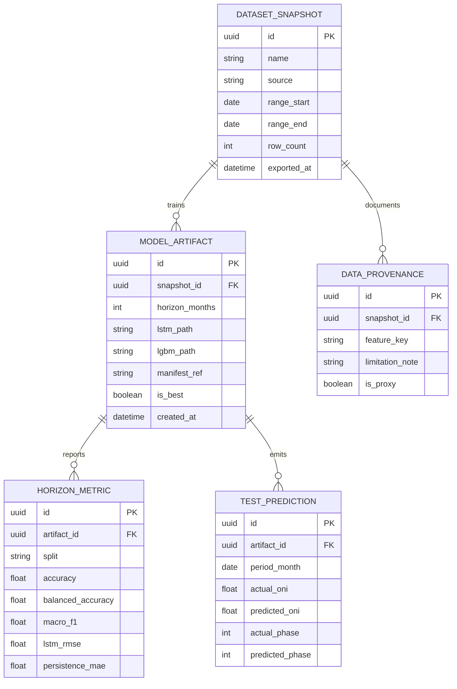

# DATABASE.md: Product

## 1. Persistence Scope

Lautan.id is a **static-snapshot SPA**; all dashboard values originate from `frontend/src/data/realData.js`, generated offline from CSV + model artifacts (see PRD). A database is therefore **not required for serving the UI**. The PostgreSQL 16 + Prisma v6 layer exists to support the **FastAPI backend** (`backend/`, currently only `Dockerfile` + `requirements.txt`) for future ingestion, artifact registry, and audit — see `ARCHITECTURE.md`. All tables below are **TBD-confirmable**; no interview answers were recorded (DECISIONS.md), so schema is derived from PRD data contracts.

**In scope (5 core tables max):** dataset ingestion, model artifact registry, per-horizon metrics, per-row predictions, and provenance/limitations.

## 2. ERD



## 3. Table Definitions

### 3.1 DATASET_SNAPSHOT

| Column | Type | Constraints |
|:---|:---|:---|
| id | UUID | PK, default gen_random_uuid() |
| name | VARCHAR(120) | UK, NOT NULL |
| source | VARCHAR(64) | NOT NULL (OISST/CPC/PSL) |
| range_start | DATE | NOT NULL (2016-01-01) |
| range_end | DATE | NOT NULL (2025-06-01) |
| row_count | INT | NOT NULL, default 114 |
| exported_at | TIMESTAMPTZ | NOT NULL, default now() |

Index: `UK(name)`, `IDX(range_end)`.

### 3.2 MODEL_ARTIFACT

| Column | Type | Constraints |
|:---|:---|:---|
| id | UUID | PK |
| snapshot_id | UUID | FK → DATASET_SNAPSHOT, NOT NULL |
| horizon_months | INT | NOT NULL, CHECK IN (1,3,6) |
| lstm_path | TEXT | NOT NULL (`model/enso_ensemble_{h}m/lstm_horizon_{h}m.pt`) |
| lgbm_path | TEXT | NOT NULL |
| manifest_ref | TEXT | NULL (`model_manifest.json`) |
| is_best | BOOLEAN | NOT NULL, default false |
| created_at | TIMESTAMPTZ | NOT NULL, default now() |

Index: `UK(snapshot_id, horizon_months)`. Partial index `is_best=true` — apply via raw SQL (see §5).

### 3.3 HORIZON_METRIC

| Column | Type | Constraints |
|:---|:---|:---|
| id | UUID | PK |
| artifact_id | UUID | FK → MODEL_ARTIFACT, NOT NULL |
| split | VARCHAR(8) | NOT NULL, CHECK IN (val,test) |
| accuracy | NUMERIC(5,4) | NOT NULL |
| balanced_accuracy | NUMERIC(5,4) | NULL |
| macro_f1 | NUMERIC(5,4) | NULL |
| lstm_rmse | NUMERIC(6,4) | NOT NULL |
| persistence_mae | NUMERIC(6,4) | NULL |

Index: `UK(artifact_id, split)`.

### 3.4 TEST_PREDICTION

| Column | Type | Constraints |
|:---|:---|:---|
| id | UUID | PK |
| artifact_id | UUID | FK → MODEL_ARTIFACT, NOT NULL |
| period_month | DATE | NOT NULL |
| actual_oni | NUMERIC(6,4) | NOT NULL |
| predicted_oni | NUMERIC(6,4) | NOT NULL |
| actual_phase | SMALLINT | NOT NULL, CHECK IN (0,1,2) |
| predicted_phase | SMALLINT | NOT NULL, CHECK IN (0,1,2) |

Index: `UK(artifact_id, period_month)`.

### 3.5 DATA_PROVENANCE

| Column | Type | Constraints |
|:---|:---|:---|
| id | UUID | PK |
| snapshot_id | UUID | FK → DATASET_SNAPSHOT, NOT NULL |
| feature_key | VARCHAR(80) | NOT NULL |
| limitation_note | TEXT | NOT NULL |
| is_proxy | BOOLEAN | NOT NULL, default false |

Index: `UK(snapshot_id, feature_key)`. Populated from PRD limitations (MHW mostly zero, rain proxy, persistence baseline).

## 4. Prisma Schema

```prisma
generator client { provider = "prisma-client-js" }
datasource db { provider = "postgresql"; url = env("DATABASE_URL") }

model DatasetSnapshot {
  id          String          @id @default(uuid()) @db.Uuid
  name        String          @unique @db.VarChar(120)
  source      String          @db.VarChar(64)
  rangeStart  DateTime        @map("range_start") @db.Date
  rangeEnd    DateTime        @map("range_end") @db.Date
  rowCount    Int             @default(114) @map("row_count")
  exportedAt  DateTime        @default(now()) @map("exported_at")
  artifacts   ModelArtifact[]
  provenance  DataProvenance[]
  @@index([rangeEnd])
  @@map("dataset_snapshot")
}

model ModelArtifact {
  id            String          @id @default(uuid()) @db.Uuid
  snapshotId    String          @map("snapshot_id") @db.Uuid
  horizonMonths Int             @map("horizon_months")
  lstmPath      String          @map("lstm_path")
  lgbmPath      String          @map("lgbm_path")
  manifestRef   String?         @map("manifest_ref")
  isBest        Boolean         @default(false) @map("is_best")
  createdAt     DateTime        @default(now()) @map("created_at")
  snapshot      DatasetSnapshot @relation(fields: [snapshotId], references: [id])
  metrics       HorizonMetric[]
  predictions   TestPrediction[]
  @@unique([snapshotId, horizonMonths])
  // Partial index (is_best = true) — apply via raw SQL migration
  @@map("model_artifact")
}

model HorizonMetric {
  id               String        @id @default(uuid()) @db.Uuid
  artifactId       String        @map("artifact_id") @db.Uuid
  split            String        @db.VarChar(8)
  accuracy         Decimal       @db.Decimal(5, 4)
  balancedAccuracy Decimal?      @map("balanced_accuracy") @db.Decimal(5, 4)
  macroF1          Decimal?      @map("macro_f1") @db.Decimal(5, 4)
  lstmRmse         Decimal       @map("lstm_rmse") @db.Decimal(6, 4)
  persistenceMae   Decimal?      @map("persistence_mae") @db.Decimal(6, 4)
  artifact         ModelArtifact @relation(fields: [artifactId], references: [id])
  @@unique([artifactId, split])
  @@map("horizon_metric")
}

model TestPrediction {
  id             String        @id @default(uuid()) @db.Uuid
  artifactId     String        @map("artifact_id") @db.Uuid
  periodMonth    DateTime      @map("period_month") @db.Date
  actualOni      Decimal       @map("actual_oni") @db.Decimal(6, 4)
  predictedOni   Decimal       @map("predicted_oni") @db.Decimal(6, 4)
  actualPhase    Int           @map("actual_phase") @db.SmallInt
  predictedPhase Int           @map("predicted_phase") @db.SmallInt
  artifact       ModelArtifact @relation(fields: [artifactId], references: [id])
  @@unique([artifactId, periodMonth])
  @@map("test_prediction")
}

model DataProvenance {
  id             String          @id @default(uuid()) @db.Uuid
  snapshotId     String          @map("snapshot_id") @db.Uuid
  featureKey     String          @map("feature_key") @db.VarChar(80)
  limitationNote String          @map("limitation_note")
  isProxy        Boolean         @default(false) @map("is_proxy")
  snapshot       DatasetSnapshot @relation(fields: [snapshotId], references: [id])
  @@unique([snapshotId, featureKey])
  @@map("data_provenance")
}
```

## 5. Raw SQL — Partial Unique Index

```sql
CREATE UNIQUE INDEX uq_model_artifact_best
  ON model_artifact (snapshot_id)
  WHERE is_best = true;
```

## 6. Notes & Open Items

- Phase encoding: `0 = La Niña, 1 = Netral, 2 = El Niño` (matches PRD LightGBM `num_class = 3`).
- `TEST_PREDICTION` mirrors `test_predictions_horizon_{h}m.csv`; `HORIZON_METRIC` mirrors `metrics_horizon_{h}m.json`.
- Auth (Clerk v6) tables are **out of scope** — no role defined (`TBD`, see DECISIONS.md).
- Retention, write API, and migration cadence: `TBD`.
- Frontend never reads this DB; see `ARCHITECTURE.md` for the export pipeline contract.